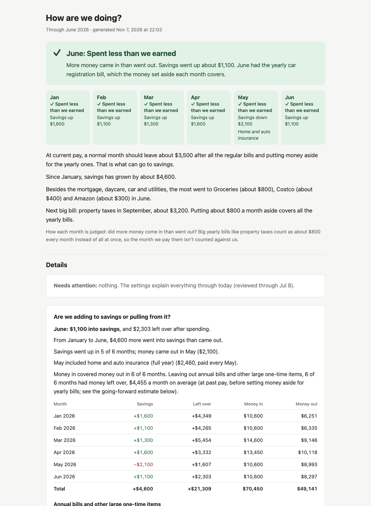

# finance-tracker

A personal finance pipeline I run for my household. It pulls bank and credit card transactions from Plaid into Postgres, checks that the numbers reconcile, and builds a monthly report that answers one question in plain language: **are we living within our means?** The report is emailed automatically each month.



*Screenshot from the demo database: every name and number above is made up.*

## Why

Budgeting apps show dashboards. The person in our house who asks "how are we doing?" isn't a numbers person and doesn't want one. So the report leads with a one-line verdict per month, round numbers and a few plain sentences, with the detailed tables underneath for me.

## What it does

- **Syncs transactions** with Plaid's cursor-based `/transactions/sync`: follows pagination, applies added, modified and removed transactions, restarts if the data changes mid-sync, and only saves the cursor after every page is written. If a bank login expires, that bank is rolled back, the others still sync, and the run fails with instructions.
- **Classifies spending** with rules that reflect how a household actually works: savings transfers and credit card payments aren't spending, the mortgage is never a "one-off", yearly bills (property taxes, insurance) are spread out as a monthly set-aside, and purchases a group trip paid back are shown net.
- **Judges each month with one rule**, "did we spend less than we earned?", counting yearly bills as their monthly share so a property-tax month isn't marked down.
- **Checks itself before writing anything**: about 160 to 200 checks (depending on how many months there are) confirm that every breakdown of the same money agrees (categories, fixed vs. variable, accounts, cash flow), that savings and card payments never leak into spending, and that the verdict and schedule logic behave as intended. Any failure stops the report.
- **Flags what it can't explain**: a "needs attention" list for paychecks that changed, unexplained large items, uncategorized spending, overdue bills or a stale sync, so hand-entered settings don't silently go stale.
- **Runs on a schedule**: a launchd agent runs it weekly and emails the full report monthly through Mail.app, catching up after the laptop was asleep or off.
- **Card status emails**: for a credit card only one partner can log in to, a weekly email with the current billing cycle's spending, every purchase and return, and the card balance (from Plaid's free cached balances), plus a wrap-up when the cycle closes.

## Design notes

- **Code writes every number.** A local LLM (Llama 3.1 8B via Ollama) only writes a one-sentence opener from a month name and a direction word, and that sentence is rejected if it contains numbers, superlatives, advice or the wrong direction. Earlier versions let the model write the whole narrative; in testing it mislabeled most of them (calling spending a "balance", inventing which account money came from), so it was cut back to the one thing it can't get wrong.
- **Personal settings live outside the code**, in `household.toml` (gitignored). `household.example.toml` documents every setting with made-up values, and the tests build their cases from whichever config is active.
- **All SQL is in one module** (`queries.py`); every report section is a function of the same queries, which is what makes the reconciliation checks meaningful.

## Run it

Requires Python 3.12+ and Postgres. Ollama is optional (the report falls back to a fixed opening sentence).

```bash
python -m venv venv && source venv/bin/activate
pip install plaid-python psycopg2-binary python-dotenv matplotlib ollama
createdb finance_tracker_demo
python demo/make_demo_data.py postgresql:///finance_tracker_demo
DATABASE_URL=postgresql:///finance_tracker_demo HOUSEHOLD_CONFIG=household.example.toml \
  REPORT_DATE=2026-07-08 python generate_report.py --out output/demo/demo_report.html
```

For real data: create a database from `schema.sql`, put `PLAID_CLIENT_ID`, `PLAID_SECRET` and `DATABASE_URL` in `.env`, link a bank (Plaid Quickstart, then `link_account.py`), copy `household.example.toml` to `household.toml`, and run `sync_transactions.py` then `generate_report.py`.

## Layout

| File | Purpose |
|---|---|
| `sync_transactions.py` | Plaid sync into Postgres |
| `queries.py` | All SQL and classification rules |
| `generate_report.py` | The HTML report (runs the checks first) |
| `generate_narrative.py` | Templated narrative + checked LLM opener |
| `generate_charts.py` | Matplotlib charts, embedded in the report |
| `checks.py` | Reconciliation and rule checks |
| `attention.py` | "Needs attention" flags |
| `card_report.py` | Billing-cycle status email for a card someone else can't log in to |
| `scheduler.py` | Weekly, monthly and card-cycle runs, email via Mail.app |
| `household.py`, `household.example.toml` | Personal settings loader and documented example |
| `demo/make_demo_data.py` | Synthetic demo database |
| `schema.sql` | Database schema |
